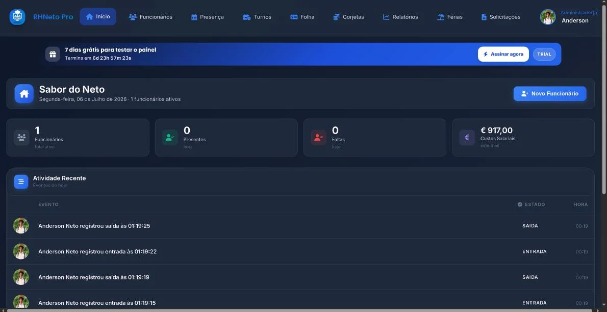
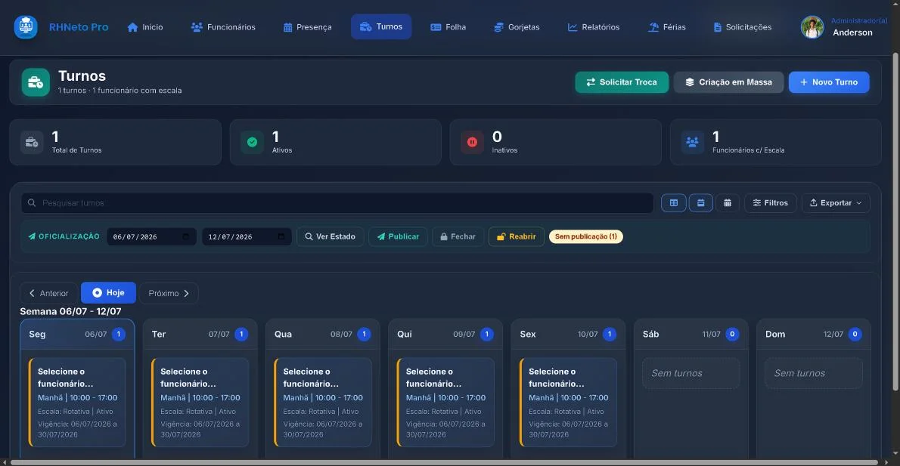

# RHNeto Pro — restaurant staff management

RHNeto Pro replaces the spreadsheets and paper that small restaurants use to manage their teams. It has two environments on the same database:

- a **management panel** for the owner or manager: staff, time clock, shifts, payroll with tips, holidays, requests and reports;
- an **employee app** where staff clock in and out, log tips and ask for holidays or shift swaps.

Final project (PAP) of the Management Informatics Technician course at Escola Profissional de Murça, 2025/26 — graded **20/20**. Built individually: requirements, database design, PHP back-end and both interfaces.


## Screenshots

| Management panel | Shifts | Payroll |
|---|---|---|
|  |  |  |

## Features

**Management panel**
- Staff records with attached documents and an exportable PDF profile
- Time clock: clock-in, breaks and clock-out, with lateness and absences calculated
- Shifts one by one or in bulk, fixed or rotating schedules, and swaps between colleagues
- Payroll with tips included, bulk payments, month closing and CSV export
- Tips with source, payment method and status
- Holiday requests and a single request centre to approve or reject
- Reports with indicators per employee
- Subscription with a free trial and Stripe payments

**Employee app** (PIN login)
- Clock in and out, log tips, see hours and the month's estimated pay
- Payslips, shifts, holiday and shift-swap requests
- SMS (Infobip) and email (Brevo) notifications

## Technical decisions

- **Two environments, one database.** The panel and the employee app read and write the same tables, linked to the employee by foreign keys — the main technical challenge of the project.
- **Employees propose, management approves.** Manual clock entries, tips, holidays and shift swaps arrive as requests in one place, where the admin approves or rejects them.
- **A closed month does not change.** Once payroll is closed for a month it no longer accepts edits, so paid amounts stay stable.
- **Secrets out of the code.** Database, Stripe, SMTP and Infobip credentials are read from a `.env` file that is never committed.

## Tech stack

**Front-end:** HTML · CSS · JavaScript  
**Back-end:** PHP (PDO / MySQLi) · Composer  
**Database:** MySQL  
**Integrations:** Stripe (`stripe/stripe-php`) · Brevo SMTP (`phpmailer/phpmailer`) · Infobip SMS

## Running locally

Requirements: PHP 8.1+ (PDO, MySQLi, GD, json, mbstring), MySQL and Apache — XAMPP works on Windows.

```bash
composer install
cp .env.example .env          # fill in the database; leave INFOBIP_ENABLED=false
```

1. Create a MySQL database and import `database/sql/install_professional_schema_hostinger.sql`.
2. Put the project in your web root (for example `htdocs/app-rhnetopro`).
3. Open the management panel at `http://localhost/app-rhnetopro/admin/views/login.php` and register the first administrator.
4. The employee app is at `http://localhost/app-rhnetopro/app/employee_login.php`.

Full technical documentation (in Portuguese): [`PROJECT_DOCUMENTATION.md`](PROJECT_DOCUMENTATION.md).

## Author

Built by **Anderson Neto** — [Portfolio](https://andersonneto.gt.tc) · [LinkedIn](https://linkedin.com/in/anderson-fullstack-developer)
